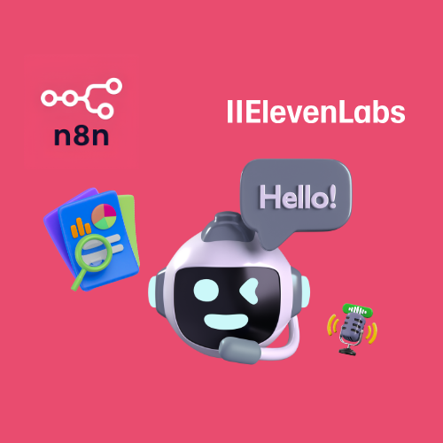

# ElevenLabs Supabase Voice RAG Agent

An n8n workflow that answers questions over HTTP with a retrieval-augmented generation (RAG) agent. The agent searches a Supabase vector store, keeps chat history in Postgres, and replies in one sentence with a source citation.

## Overview

The workflow exposes a webhook endpoint that accepts POST requests. Each request goes to an AI agent that retrieves relevant document chunks from a Supabase vector store, reranks them, and writes a single-sentence answer grounded in those chunks. A cleanup step then strips double quotes from the answer, and the webhook returns the result to the caller.

## Workflows

| Workflow | Trigger | Purpose |
| --- | --- | --- |
| ElevenLabs Supabase Voice RAG Agent | Webhook (POST) | Answers a query in one sentence using Supabase vector retrieval, Cohere reranking, and Postgres chat memory. |

## Workflow Details

### ElevenLabs Supabase Voice RAG Agent

This workflow answers each incoming request with a single cited sentence drawn only from the vector store.

**Trigger:** A Webhook node listens for POST requests and hands the response to a Respond to Webhook node at the end of the run.

Execution steps:

1. The Webhook node receives the request and passes it to the AI Agent node.
2. The AI Agent node runs a system prompt that defines it as a business RAG agent.
3. The agent calls the Gemini 2.5 Flash chat model and switches to the Gemini 2.5 Flash Lite chat model as a fallback.
4. The agent loads the last 10 messages from the Postgres Chat Memory node.
5. The agent queries the Supabase Vector Database tool, which embeds the query with Google Gemini embeddings and retrieves the top 10 chunks.
6. The Cohere reranker reorders the retrieved chunks before the agent reads them.
7. The agent writes one sentence followed by a source citation on a separate line.
8. A Set node removes double quote characters from the `output` field.
9. The Respond to Webhook node returns all incoming items to the caller.

Rules enforced by the system prompt:

- The answer is exactly one sentence.
- The answer uses only information retrieved from the vector store.
- The agent cites up to three sources after the sentence.
- When retrieval returns nothing, the agent replies that no relevant information was found in the knowledge base.
- The agent refuses requests to drop the one-sentence limit.

The workflow has no branches, loops, or sub-workflow calls. Its settings reference an error workflow that is not part of this repository.

Integrations used: Google Gemini, Supabase, Postgres, Cohere.

## Integrations

- Google Gemini: chat models and text embeddings
- Supabase: vector store used as the agent's retrieval tool
- Postgres: chat memory
- Cohere: reranking of retrieved chunks

## Prerequisites

- An n8n instance that includes the LangChain AI nodes and the AI Agent node with fallback model support.
- A Google Gemini (Google AI) API credential.
- A Supabase API credential and a Supabase project with a vector table that holds your documents.
- A Postgres credential for a database that n8n can write to.
- A Cohere API credential.

## Setup

1. Import `workflows/ElevenLabs_Supabase_Voice_RAG_Agent.json` into n8n.
2. Create the Google Gemini, Supabase, Postgres, and Cohere credentials in n8n.
3. Assign each credential to its nodes: both Gemini chat models and the embeddings node, the Supabase Vector Database node, the Postgres Chat Memory node, and the Reranker Cohere node.
4. Select your own vector table in the Supabase Vector Database node.
5. Open the workflow settings and assign an error workflow or clear the existing reference.
6. Review the Webhook node and add the authentication your deployment requires.
7. Activate the workflow and send a POST request to its production webhook URL.
